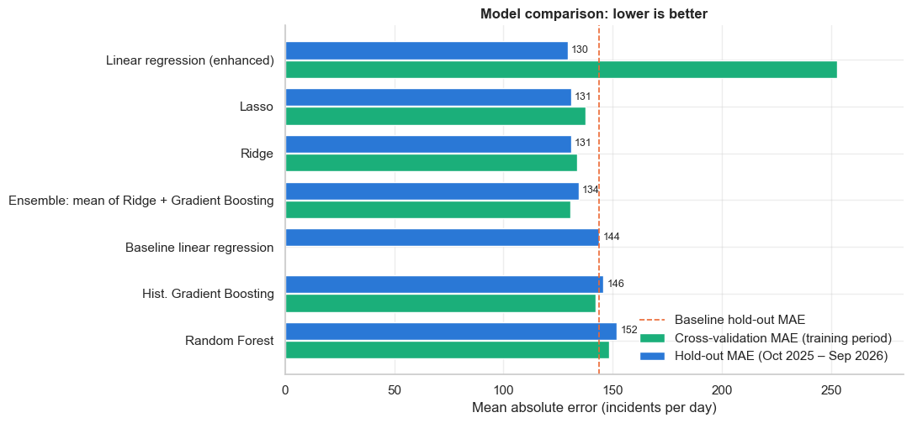
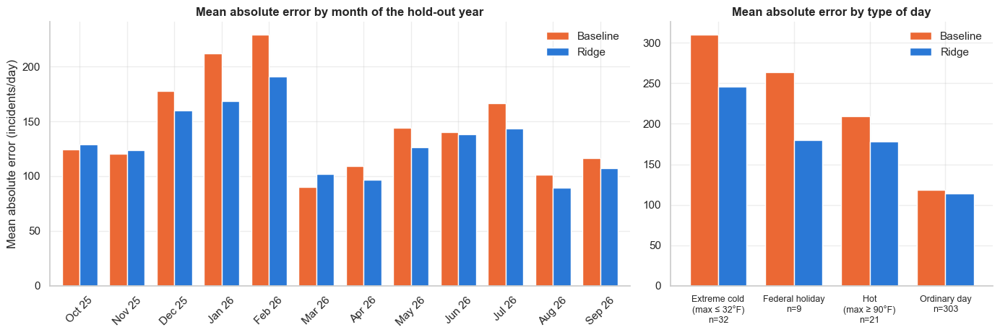
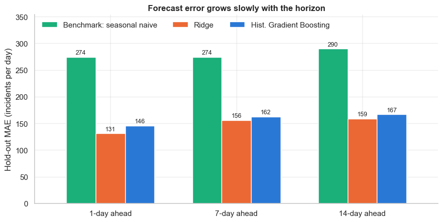

### Forecasting Daily Emergency Medical Demand in New York City

**Author:** Tiya Lee

#### Executive summary
Emergency demand in New York City swings by hundreds of 911 medical calls from one day to the next, which makes ambulance crew scheduling and hospital surge planning difficult. This project asks whether publicly available daily emergency incident counts, combined with weather and calendar information, can predict citywide daily emergency medical demand accurately enough to be useful for operational planning.

Using the FDNY EMS Incident Dispatch Data for the most recent three-plus years of normal, post-pandemic operations (January 2023 – September 2026, 1,369 days), the project found that demand is stable at about 4,430 incidents per day, that the **time of year and the temperature are the strongest drivers** (hot days add several hundred incidents and extreme cold raises demand again), that **weekends are quieter**, and that **holidays cut both ways** (Thanksgiving and Christmas are the quietest days of the year; New Year's Day and Independence Day are among the busiest).

Seven forecasting approaches were compared on the same untouched final year of data (October 2025 – September 2026). The recommended model, a **regularised (Ridge) linear regression** using calendar, weather, holiday-specific and recent-history features, predicts daily citywide volume with a **typical error of 131 incidents per day, or 3.0% of daily volume**. That is 9% better than the baseline model from the first phase of the project, 40% better than assuming "tomorrow looks like today", and more than 50% better than assuming "next Tuesday looks like last Tuesday". Forecasting a full week ahead, the horizon that matters for crew rosters, the typical error rises only to about 156 incidents, still 43% below the rule of thumb. The gains over the baseline are concentrated on exactly the days planners worry about most: cold snaps, heat waves and holidays.

#### Rationale
EMS agencies and hospital emergency departments must schedule crews, ambulances and clinical staff days to weeks in advance, yet daily demand is volatile. Under-staffing on a busy day lengthens response times and worsens outcomes; over-staffing on a quiet day wastes scarce resources. About 60% of NYC EMS incidents end with a patient transported to a hospital emergency department, so daily EMS volume is both a direct measure of ambulance demand and a leading indicator of ED arrivals. A forecast that is accurate to within a few percent, and that explains *why* a day will be busy (heat wave, cold snap, holiday), gives operations managers a concrete input to staffing and surge planning. Because the data are public and refreshed monthly, the approach is reproducible and can be kept current.

#### Research Question
Can historical emergency demand data, weather, and calendar factors be used to predict daily citywide emergency medical (911 EMS) incident volume in New York City?

#### Data Sources
| Source | Content | Grain |
|---|---|---|
| [FDNY EMS Incident Dispatch Data](https://data.cityofnewyork.us/Public-Safety/EMS-Incident-Dispatch-Data/76xm-jjuj) (NYC Open Data, refreshed monthly) | Every 911 medical incident since 2005: timestamps, call type, severity, hospital arrival, borough | Aggregated server-side to one row per day (citywide) and one row per day × borough, 2022-12-01 to 2026-09-30; about 6.2 million incidents |
| [Open-Meteo Historical Weather API](https://open-meteo.com/en/docs/historical-weather-api) (ERA5 reanalysis at Central Park) | Daily max/min/mean temperature, precipitation, rain, snowfall, max wind speed, mean relative humidity | 1,400 daily rows |
| `holidays` Python package | US federal holiday calendar | daily flags |

All files are saved in [data/](data/) so the notebooks run offline. December 2022 is included only as a run-in so that lag features exist for the first days of 2023. All data are aggregate public counts; no patient-level information is used.

**Changes since the Module 16 proposal.** The proposal targeted daily emergency department (ED) visit counts from the NYC syndromic surveillance system. That public series only covers March 2020 – December 2022, the COVID-19 period, which is not representative of normal operations. The project therefore switched to the FDNY EMS incident data, which is available from 2005 to the present, and uses the most recent three-plus years so that the findings reflect current conditions. Daily EMS incidents replace daily ED visits as the target variable; the methodology (EDA, calendar and weather features, time-series split, regression models, MAE/RMSE evaluation) is unchanged.

#### Methodology
The work is split across two notebooks that share one train/test split and one set of metrics.

**Notebook 1: data preparation, exploration and baseline**
1. **Data cleaning.** Parsed dates, verified there were no missing days, duplicate dates or missing values, checked logical consistency (hospital transports ≤ incidents, high-acuity ≤ incidents, no negatives), checked that borough totals reconcile to citywide totals, dropped the negligible `UNKNOWN` borough label, and merged daily weather. A year-by-year check showed that the operational fields drift over time (the hospital-transport share falls from 62% to 57% and mean response time nearly doubles between 2023 and 2026), so only the incident count, which is fixed at dispatch, is used as the target.
2. **Feature engineering.** Day of week, weekend, month, season, US federal holiday and day-after-holiday flags, extreme-weather flags (hot, freezing, heavy precipitation, snow day), and recent-history features (incidents 1, 7 and 14 days earlier, trailing 7-day and 28-day means). All recent-history features use strictly past information.
3. **Exploratory data analysis.** Time-series plots, distributions, day-of-week and monthly boxplots, holiday-effect analysis controlling for weekday and month, weather scatterplots, a correlation heatmap, autocorrelation plots, borough and call-type views, and an outlier analysis that found events (Thanksgiving, heat waves) rather than data errors.
4. **Baseline modeling.** A time-ordered split (train 2023-01-01 to 2025-09-30, 1,004 days; test 2025-10-01 to 2026-09-30, 365 days), two non-ML benchmarks (naive and seasonal naive) and a plain linear regression on calendar, weather and lag features.

**Notebook 2: model comparison, tuning and evaluation**
5. **Richer features suggested by the EDA.** Holiday-specific indicators (New Year's Day, Independence Day, Thanksgiving, Christmas, Christmas Eve, New Year's Eve, day before a holiday), non-linear temperature terms (heating and cooling degree-days, squared temperature, extreme-cold flag), smooth annual-cycle (Fourier) terms, a 28-day lag and recent volatility.
6. **Model tuning and selection.** Five model families (Linear Regression, Ridge, Lasso, Random Forest, Histogram Gradient Boosting) plus a Ridge + Gradient Boosting ensemble were tuned by **grid search over five rolling-origin (time-series) cross-validation folds** inside the training period. The final model was chosen by cross-validated error, and the hold-out year was scored once at the end.
7. **Interpretation.** Permutation importance, a what-if temperature curve, Lasso feature selection, and error breakdowns by month and by type of day (extreme cold, hot, holiday, ordinary).
8. **Forecast horizon.** The lag features were rebuilt so the model may only use volumes at least 7 or 14 days old, to measure how accuracy degrades at the horizons used for roster planning.

**Evaluation metric.** **Mean absolute error (MAE)** is the primary metric because it is expressed in incidents per day, which maps directly onto crew-hours, and it does not over-weight a handful of extreme days. Root mean squared error (RMSE) is reported to expose large misses, and mean absolute percentage error (MAPE) expresses the error as a share of daily volume so it can be compared across periods or boroughs of different size.

#### Results
**What the data show (Notebook 1)**

| Finding | Evidence |
|---|---|
| Demand is stable with no trend | Yearly means of 4,432 (2023), 4,455 (2024), 4,417 (2025) and 4,412 (2026 to date); standard deviation about 275 per day |
| The annual cycle is the strongest regular pattern | Mean of 4,647 incidents/day in June vs. 4,247 in March; secondary bump in December |
| The weekly cycle is modest | Friday averages 4,569, Sunday 4,204 (9% gap); weekdays are flat |
| Temperature is the strongest external driver | Hot days (≥ 90°F) average 380 more incidents; demand rises again below about 25°F |
| Snow and rain suppress demand | Snow days (≥ 1 in) average 303 fewer incidents; heavy-rain days 108 fewer |
| Holidays cut both ways | Thanksgiving −14% and Christmas −12% vs. a comparable weekday; New Year's Day +9% and observed Independence Day +12% |
| Volume is spread across boroughs | Brooklyn 27.6%, Manhattan 24.2%, Bronx 23.5%, Queens 20.5%, Staten Island 4.3%; all share the same seasonal rhythm |

**Model comparison on the hold-out year (2025-10-01 to 2026-09-30, 365 days, average 4,395 incidents/day)**

| Model | Cross-validated MAE | Hold-out MAE | RMSE | MAPE |
|---|---|---|---|---|
| Benchmark: naive (yesterday's value) | – | 218 | 282 | 5.0% |
| Benchmark: seasonal naive (same weekday last week) | – | 274 | 351 | 6.3% |
| Baseline: linear regression, original features (Notebook 1) | – | 144 | 195 | 3.3% |
| Linear regression, enhanced features | 253 ± 249 | 130 | 171 | 3.0% |
| **Ridge regression, enhanced features (recommended)** | **134 ± 30** | **131** | **172** | **3.0%** |
| Lasso regression, enhanced features | 137 ± 35 | 131 | 172 | 3.0% |
| Ensemble: mean of Ridge and Gradient Boosting | 131 ± 25 | 134 | 173 | 3.1% |
| Histogram Gradient Boosting (tuned) | 142 ± 23 | 146 | 186 | 3.3% |
| Random Forest (tuned) | 148 ± 16 | 152 | 195 | 3.5% |

**Key findings**

1. **The recommended model forecasts tomorrow's citywide EMS volume to within about 3%.** Ridge regression on the enhanced feature set has a typical error of 131 incidents on a 4,400-incident day, 9% better than the Notebook 1 baseline and far better than either rule-of-thumb benchmark. Lasso and the ensemble are within a few incidents of it.
2. **Better features mattered more than fancier algorithms.** Giving a linear model holiday-specific flags, degree-days, a squared temperature term and smooth seasonal terms delivered the whole improvement. The tuned Random Forest and Gradient Boosting models, despite 27 and 48 hyperparameter combinations each, did not beat regularised regression. With about 1,000 training days and a smooth, mostly additive signal, that is the expected outcome, and it means the recommended model is a transparent weighted sum that planners can inspect.
3. **Regularisation is what makes the richer model trustworthy.** The un-regularised linear regression on 51 features had the lowest hold-out error but was wildly unstable in cross-validation (it extrapolates badly when trained on only a few months). Ridge gives the same accuracy with stable behaviour, which is why the model was selected on cross-validated error rather than on the test year.
4. **The improvement lands on the days that matter most.** Compared with the baseline, the mean error on extreme-cold days fell from 310 to 246 incidents (−21%), on federal holidays from 264 to 180 (−32%) and on hot days from 210 to 178 (−15%), while ordinary days improved only slightly (118 to 114) because they were already well predicted. The model learned that demand turns back up below freezing and accelerates above 90°F, which a straight-line temperature effect cannot represent.
5. **What drives the forecast.** In order of importance: daily maximum temperature, time of year, whether it is a Saturday or Sunday, minimum temperature and the non-linear temperature terms, and how busy yesterday was. These match the exploratory findings and give operations managers a short, intuitive list of reasons a day will be busy.
6. **A week-ahead forecast is still useful.** Moving from 1 to 7 days ahead raises the Ridge error from 131 to 156 incidents, and 14 days ahead to 159, while the seasonal-naive rule stays near 275–290. A 7-day-ahead forecast is therefore still about 43% more accurate than the rule of thumb (using observed weather as a stand-in for a weather forecast).
7. **The remaining misses are rare, extreme days:** the first days of the late-January 2026 cold snap, the 102°F day on 2 July 2026, Independence Day 2026 falling on a hot Saturday, and the February 2026 snowstorm. These are the days when a human planner should add a safety margin on top of the forecast.

**Recommendations for an EMS or hospital operations team**
- **Adopt the Ridge model as the daily citywide demand forecast**, refreshed monthly as new dispatch data are published, and publish the 7-day-ahead version for roster planning. Expect the forecast to be within about 3% of actual volume on a typical day.
- **Build surge triggers around the drivers the model identified.** Forecast highs at or above 90°F, forecast highs at or below freezing, New Year's Day and Independence Day should automatically raise staffing above the forecast. Thanksgiving and Christmas Day can safely run lighter.
- **Report every forecast with an error band of about ±130 incidents** (one typical error) so planners can size margins instead of treating the point forecast as exact.

#### Next steps
- Train and evaluate the 7- and 14-day-ahead models on **archived weather forecasts** rather than observed weather, so the horizon results reflect real operating conditions.
- Extend from citywide to **borough-level and hospital-transport-level forecasts**, which are the direct feed into individual emergency departments, and to **hourly resolution** for shift planning.
- Add **prediction intervals** (for example quantile regression) so the forecast communicates uncertainty directly rather than through a fixed error band.
- Incorporate **respiratory-illness surveillance** to explain the December rise, and revisit the tree-based models once more post-pandemic history has accumulated, since they are the most likely to benefit from additional rare-event examples.

#### Outline of project
- [01_eda_and_baseline.ipynb](01_eda_and_baseline.ipynb): data loading, cleaning, feature engineering, exploratory data analysis, outlier analysis and the baseline linear regression
- [02_modeling_and_evaluation.ipynb](02_modeling_and_evaluation.ipynb): enhanced features, cross-validated grid search over six models, hold-out evaluation, interpretation, forecast-horizon analysis and recommendations
- [data/](data/): daily EMS incident counts (citywide and by borough), call-type totals, and daily weather
- [images/](images/): figures exported from the notebooks
- [requirements.txt](requirements.txt): Python dependencies

To reproduce, create a Python 3.10+ environment, run `pip install -r requirements.txt`, and execute the two notebooks in order from the repository root.

##### Contact and Further Information
Tiya Lee, tlee@chartis.com
