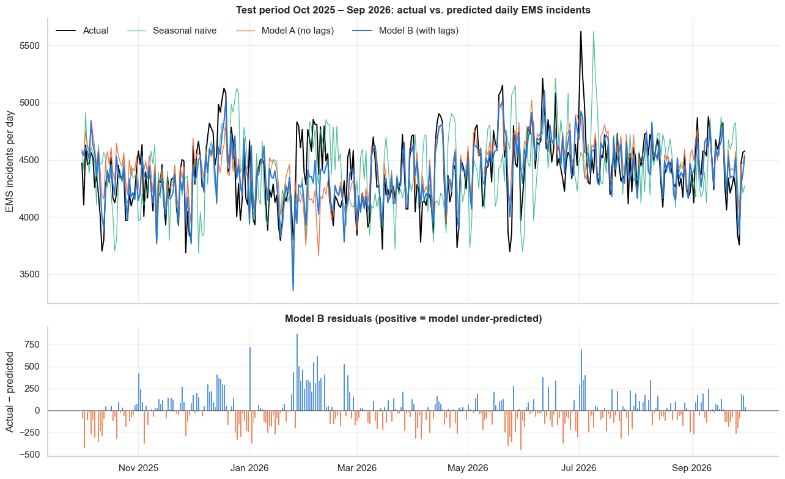

### Forecasting Daily Emergency Medical Demand in New York City

**Author:** Tiya Lee

#### Executive summary
Emergency demand in New York City swings by hundreds of 911 medical calls from one day to the next, which makes ambulance crew scheduling and hospital surge planning difficult. This project asks whether publicly available daily emergency incident counts, combined with weather and calendar information, can predict citywide daily emergency medical demand accurately enough to be useful for operational planning.

Using the FDNY EMS Incident Dispatch Data for the most recent three-plus years of normal, post-pandemic operations (January 2023 – September 2026, 1,369 days), the exploratory analysis shows that demand is stable at about 4,430 incidents per day with no trend, that the **annual cycle is the dominant pattern** (June runs about 9% above March, with a secondary December bump), that **temperature is the strongest external driver** (hot days add almost 400 incidents, and extreme cold raises demand again), and that **holidays cut both ways** (Thanksgiving and Christmas are the quietest days of the year; New Year's Day and the observed Independence Day are among the busiest). The weekly cycle is modest: Sundays run about 9% below Fridays.

A baseline **linear regression using calendar, weather and lag features**, trained on January 2023 – September 2025 and tested on the most recent twelve months (October 2025 – September 2026), predicts daily citywide volume with a **mean absolute error of 144 incidents per day (3.3% MAPE)**. That is one-third better than a naive "same as yesterday" forecast and almost half the error of a seasonal-naive forecast. This baseline will be compared against richer models in Module 24.

#### Rationale
EMS agencies and hospital emergency departments must schedule crews, ambulances and clinical staff days to weeks in advance, yet daily demand is volatile. Under-staffing on a busy day lengthens response times and worsens outcomes; over-staffing on a quiet day wastes scarce resources. About 60% of NYC EMS incidents end with a patient transported to a hospital emergency department, so daily EMS volume is both a direct measure of ambulance demand and a leading indicator of ED arrivals. A forecast that is accurate to within a few percent, and that explains *why* a day will be busy (heat wave, cold snap, holiday), gives operations managers a concrete input to staffing and surge planning. Because the data are public and refreshed monthly, the approach is reproducible and can be kept current.

#### Research Question
Can historical emergency demand data, weather, and calendar factors be used to predict daily citywide emergency medical (911 EMS) incident volume in New York City?

#### Data Sources
| Source | Content | Grain |
|---|---|---|
| [FDNY EMS Incident Dispatch Data](https://data.cityofnewyork.us/Public-Safety/EMS-Incident-Dispatch-Data/76xm-jjuj) (NYC Open Data, refreshed monthly) | Every 911 medical incident since 2005: timestamps, call type, severity, hospital arrival, borough | Aggregated server-side to one row per day (citywide) and one row per day × borough, 2022-12-01 to 2026-09-30; about 6.2 million incidents |
| [Open-Meteo Historical Weather API](https://open-meteo.com/en/docs/historical-weather-api) (ERA5 reanalysis at Central Park) | Daily max/min/mean temperature, precipitation, rain, snowfall, max wind speed, mean relative humidity | 1,400 daily rows |
| `holidays` Python package | US federal holiday calendar | daily flags |

All files are saved in [data/](data/) so the notebook runs offline. December 2022 is included only as a run-in so that lag features exist for the first days of 2023. All data are aggregate public counts; no patient-level information is used.

**Changes since the Module 16 proposal.** The proposal targeted daily emergency department (ED) visit counts from the NYC syndromic surveillance system. That public series only covers March 2020 – December 2022, the COVID-19 period, which is not representative of normal operations. The project therefore switched to the FDNY EMS incident data, which is available from 2005 to the present, and uses the most recent three-plus years so that the findings reflect current conditions. Daily EMS incidents replace daily ED visits as the target variable; the methodology (EDA, calendar and weather features, time-series split, linear regression baseline, MAE/RMSE evaluation) is unchanged.

#### Methodology
1. **Data cleaning.** Parsed dates, verified there were no missing days, duplicate dates or missing values, checked logical consistency (hospital transports ≤ incidents, high-acuity ≤ incidents, no negatives), checked that borough totals reconcile to citywide totals, dropped the negligible `UNKNOWN` borough label from borough-level views, and merged daily weather. A year-by-year check showed that the operational fields drift over time (the hospital-transport share falls from 62% to 57% and mean response time nearly doubles between 2023 and 2026, consistent with the EMS system strain reported by the NYC Comptroller and the Mayor's Management Report), so only the incident count, which is fixed at dispatch, is used as the target.
2. **Feature engineering.** Day of week, weekend, month, season, year, day of year, US federal holiday and day-after-holiday flags, a linear time index, extreme-weather flags (hot, freezing, heavy precipitation, snow day), autoregressive features (incidents 1, 7 and 14 days earlier, trailing 7-day and 28-day means), and transport and high-acuity shares.
3. **Exploratory data analysis.** Time-series plots with rolling means, distribution plots, day-of-week and monthly boxplots, holiday-effect analysis controlling for weekday and month, weather scatterplots with a LOWESS fit, a correlation heatmap, short- and long-lag autocorrelation plots, and borough and call-type views.
4. **Outlier analysis.** A global IQR rule plus a local robust z-score against a centered 15-day window, used to separate data errors (none found) from genuine events (Thanksgiving, heat waves, quiet Sundays).
5. **Baseline modeling.** A time-ordered train/test split (train 2023-01-01 to 2025-09-30, test 2025-10-01 to 2026-09-30). Two non-ML benchmarks (naive and seasonal naive) and two linear regressions: Model A uses calendar + weather + trend; Model B adds the lag features.
6. **Evaluation.** MAE is the primary metric because it is in incidents per day and maps directly onto crew-hours. RMSE is reported to expose large misses and MAPE to allow comparison across periods or boroughs of different volume.

#### Results
**EDA findings**

| Finding | Evidence |
|---|---|
| Demand is stable with no trend | Yearly means of 4,432 (2023), 4,455 (2024), 4,417 (2025) and 4,412 (2026 to date); standard deviation about 275 per day |
| Annual cycle is the strongest regular pattern | Mean of 4,647 incidents/day in June vs. 4,247 in March; secondary bump in December |
| Weekly cycle is modest | Friday averages 4,569, Sunday 4,204 (9% gap); weekdays are flat |
| Temperature is the strongest external driver | r = +0.46 with daily maximum temperature; hot days (≥ 90°F) average 380 more incidents; the LOWESS curve turns up again below about 25°F |
| Snow and rain suppress demand | Snow days (≥ 1 in) average 303 fewer incidents; heavy-rain days 108 fewer |
| Holidays cut both ways | Thanksgiving −14% and Christmas −12% vs. a comparable weekday; New Year's Day +9% and observed Independence Day +12% |
| Volume is spread across boroughs | Brooklyn 27.6%, Manhattan 24.2%, Bronx 23.5%, Queens 20.5%, Staten Island 4.3%; all share the same seasonal rhythm |

**Baseline model performance on the hold-out period (2025-10-01 to 2026-09-30, 365 days)**

| Model | MAE (incidents/day) | RMSE | MAPE |
|---|---|---|---|
| Benchmark: naive (yesterday's value) | 218 | 282 | 5.0% |
| Benchmark: seasonal naive (same weekday last week) | 274 | 351 | 6.3% |
| Model A: linear regression, calendar + weather + trend | 177 | 235 | 4.0% |
| **Model B: linear regression, calendar + weather + lags** | **144** | **195** | **3.3%** |

Model B is the baseline carried into Module 24. Its largest standardised coefficient is maximum temperature, followed by the Saturday and Sunday dummies, the summer-month dummies and yesterday's volume, matching the EDA. The worst misses cluster in the extreme-cold spell of late January and early February 2026, when demand ran 500–900 incidents above forecast: the linear temperature term predicts fewer calls in the cold and misses the U-shaped response. New Year's Day 2026 and the 102°F day on 2 July 2026 are the other large misses.

#### Next steps
- Add tree-based and gradient-boosted models (Random Forest, XGBoost) to capture the U-shaped temperature effect and holiday × weekday interactions.
- Engineer holiday-specific indicators (New Year's, Independence Day, Thanksgiving, Christmas) and non-linear temperature features such as heating and cooling degree-days or a heat index.
- Try regularised regression (Ridge, Lasso) and Fourier terms for the annual cycle; add a same-day-last-year lag and a respiratory-season indicator for the December bump.
- Replace the single split with rolling-origin time-series cross-validation and evaluate 7- and 14-day-ahead horizons, which matter more for crew scheduling.
- Extend from citywide to borough-level forecasts and to the hospital-transport subset, which is the direct feed into emergency departments.

#### Outline of project
- [ems_demand_eda_baseline.ipynb](ems_demand_eda_baseline.ipynb): data loading, cleaning, feature engineering, EDA, outlier analysis, and baseline model
- [data/](data/): daily EMS incident counts (citywide and by borough), call-type totals, and daily weather
- [images/](images/): figures exported from the notebook
- [requirements.txt](requirements.txt): Python dependencies

##### Contact and Further Information
Tiya Lee, tlee@chartis.com
